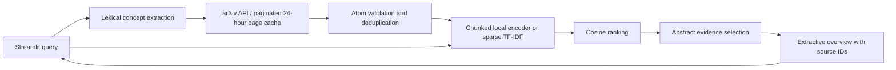

# Implemented architecture

The prototype is one Python process with Streamlit calling a UI-independent pipeline.
No backend server, vector database, hosted inference, or generative model is required.

| Component | Input | Output / purpose |
| --- | --- | --- |
| query.py | Original query | Conversational-prefix cleanup, unique concepts and AND search, or preserved quoted phrase; original intent retained for ranking |
| retrieval.py | Search expression, limit | Validated Paper records, timestamp, cache status, skipped-record count |
| models.py | Untrusted metadata | Typed records with required fields and source links |
| ranking.py | Original query, titles and abstracts | Local dense embeddings or document-fitted TF-IDF vectors |
| pipeline.py | Query, client, encoder | Ranked matches, evidence, cited excerpts, timings and provenance |
| app.py | User settings and query | Results, warnings, links, JSON download |

The external call is HTTPS GET to export.arxiv.org/api/query. Requests from the shared
client are serialized with at least 3.1 seconds between starts, a 15-second connection timeout,
a 90-second read timeout, and up to three attempts per page for transient failures. Retrieval
accepts a maximum of 10,000 raw entries, using pages of at most 1,000. Offsets advance by raw
entry counts, independently of invalid metadata and duplicates. OpenSearch totalResults stops
pagination when the available result set is exhausted. A short page with no total count or
an empty page also terminates retrieval. The usable candidate count may be below the limit.
Initial model download contacts Hugging Face.
Semantic inference thereafter is local using all-MiniLM-L6-v2 at a fixed revision in
ranking.py. The query is encoded once; title/abstract strings are processed in chunks of at
most 256 documents with inference batches of 16. Only one chunk's dense embeddings is needed
at a time; all scalar cosine scores are retained for global sorting. The lexical path uses
sparse document TF-IDF and materializes only the query-document score vector. The model can
truncate long texts, so evidence selection still uses the complete available abstract.
CPU is default; CUDA is optional through `uv sync --extra cuda` and
`uv run --extra cuda streamlit run app.py`. Availability is checked before loading the model.
TF-IDF provides a no-download lexical comparison.

Cosine is retained raw; display score = 100 * max(0, cosine). This is an uncalibrated
similarity index. Stable ties retain retrieval order. Deduplication collapses arXiv version
suffixes while preserving the first retrieved version's original identifier.

For an entirely quoted query, exact title matches (case insensitive) are placed before
other candidates, which remain sorted by cosine. This known-item rule does not change raw
or displayed similarity scores; the UI labels the priority and exports it in metadata.
It matches titles returned by arXiv and never inserts a paper by identifier.

For a query such as `graph learning`, concepts create an AND search, arXiv returns candidates,
the parser validates records, vectors are compared against the unchanged query, and the
highest-ranked papers receive the abstract sentence with greatest exact concept overlap.
Up to five such sentences form an explicitly extractive overview, each tied to its paper.
An exact-overlap explanation is incomplete evidence of semantic relevance, especially for
synonyms. No cross-paper consensus, full-text findings, or causal conclusions are generated.

Empty retrieval skips encoding. A failure before any page is retrieved appears as a UI error.
A later page failure preserves earlier candidates and produces an explicit partial-results
warning; failed pages are not cached. A retry reuses still-fresh successful pages. Each page's
timestamp and cache status is exported, so cached pages of different ages remain visible.
The progress indicator covers retrieval and ranking. Separate retrieval/ranking timings are
shown, and ui_total_seconds includes model loading. Model runtime failures appear as UI errors.
Paper text is displayed as text; source links are constructed from validated arXiv identifiers.
The cache stores retrieved metadata, not embeddings; no offline replay interface exists yet.
