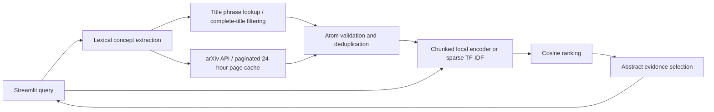
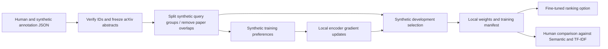

# Implemented architecture

The prototype is one Python process with Streamlit calling a UI-independent pipeline.
No backend server, vector database, hosted inference, or generative model is required.

| Component | Input | Output / purpose |
| --- | --- | --- |
| query.py | Original query | Conversational-prefix cleanup, complete title candidate, unique concepts and AND search, or preserved quoted phrase; original intent retained for ranking |
| retrieval.py | Search expression, limit | Validated Paper records, timestamp, cache status, skipped-record count |
| models.py | Untrusted metadata | Typed records with required fields and source links |
| ranking.py | Original query, titles and abstracts | Base or locally fine-tuned dense embeddings, or document-fitted TF-IDF vectors |
| pipeline.py | Query, client, encoder | Ranked matches, per-paper evidence, timings and provenance |
| app.py | User settings and query | Results, warnings, links, JSON download |

The external call is HTTPS GET to export.arxiv.org/api/query. Requests from the shared
client are serialized with at least 3.1 seconds between starts, a 15-second connection timeout,
a 90-second read timeout, and up to three attempts per page for transient failures. Retrieval
accepts a maximum of 10,000 raw entries, using pages of at most 1,000. Offsets advance by raw
entry counts, independently of invalid metadata and duplicates. OpenSearch totalResults stops
pagination when the available result set is exhausted. A short page with no total count or
an empty page also terminates retrieval. The usable candidate count may be below the limit.
Initial model download contacts Hugging Face.
Semantic inference thereafter is local using all-MiniLM-L6-v2 at a fixed revision in
ranking.py. The query is encoded once; title/abstract strings are processed in chunks of at
most 256 documents with inference batches of 16. Only one chunk's dense embeddings is needed
at a time; all scalar cosine scores are retained for global sorting. The lexical path uses
sparse document TF-IDF and materializes only the query-document score vector. The model can
truncate long texts, so evidence selection still uses the complete available abstract.
CPU is default; CUDA is optional through `uv sync --extra cuda` and
`uv run --extra cuda streamlit run app.py`. Availability is checked before loading the model.
TF-IDF provides a no-download lexical comparison.

Fine-tuned is a separate selector option loading models/finetuned-minilm and its training
manifest. The shared encoder keeps the same model inputs, cosine scoring, and chunk limits.
JSON exports identify pda/finetuned-minilm and the training run ID instead of claiming the
base revision produced its embeddings. Missing local weights produce a clear error.

The offline training flow is:

Human labels are reserved from gradient updates and checkpoint selection. This is a modeling
and evaluation workflow; live retrieval and per-paper explanations share the same pipeline.
See finetuning.md for the executed protocol, limitations, and measured regression on human data.

Cosine is retained raw; display score = 100 * max(0, cosine). This is an uncalibrated
similarity index. Stable ties retain retrieval order. Deduplication collapses arXiv version
suffixes while preserving the first retrieved version's original identifier.

Every valid query also performs an auxiliary `ti:"complete title candidate"` lookup for up
to 50 entries. It preserves all words, independent of topic stopword removal, and filters
returned papers by complete-title equality after Unicode NFKC, whitespace, and case
normalization. ASCII and smart outer quotes are accepted but not required. No title-prefix
or substring match receives exact-title priority. Quotes embedded inside title candidates
are sanitized before constructing the API expression.

Exact returned titles are merged with topic candidates and deduplicated by base arXiv ID,
with the combined usable pool capped at the requested limit. The auxiliary lookup can scan
up to 50 entries in addition to the topic entry budget; it uses the same rate limit/cache.
Exact titles precede other candidates, which remain sorted by cosine. Raw and displayed
cosine scores are unchanged. The UI labels title priority, and `title_lookup` records its
query, timestamps, cache status, and matching IDs. No paper is inserted by identifier.
Failed title lookup falls back to topic search with a visible warning; if only topic search
fails, successfully retrieved exact titles remain available with a partial-results warning.

For a query such as `graph learning`, concepts create an AND search, arXiv returns candidates,
the parser validates records, vectors are compared against the unchanged query, and the
highest-ranked papers receive the abstract sentence with greatest exact concept overlap.
Each ranked paper retains its abstract, selected evidence, similarity score, and source link.
The user can request 5–50 displayed papers in increments of 5, with a default of 10.
The abstract-based overview was removed from both results and JSON export at the user's
request. An exact-overlap explanation remains incomplete evidence of semantic relevance,
especially for synonyms. No cross-paper consensus or full-text conclusions are generated.

Empty retrieval skips encoding. A failure before any page is retrieved appears as a UI error.
A later page failure preserves earlier candidates and produces an explicit partial-results
warning; failed pages are not cached. A retry reuses still-fresh successful pages. Each page's
timestamp and cache status is exported, so cached pages of different ages remain visible.
The progress indicator covers retrieval and ranking. Separate retrieval/ranking timings are
shown, and ui_total_seconds includes model loading. Model runtime failures appear as UI errors.
Paper text is displayed as text; source links are constructed from validated arXiv identifiers.
The cache stores retrieved metadata, not embeddings; no offline replay interface exists yet.
