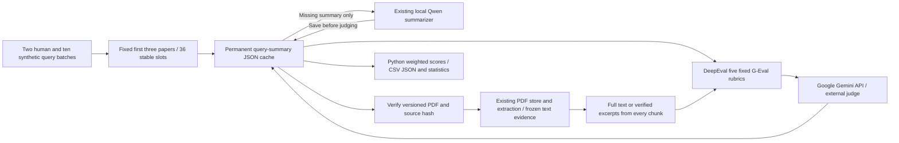
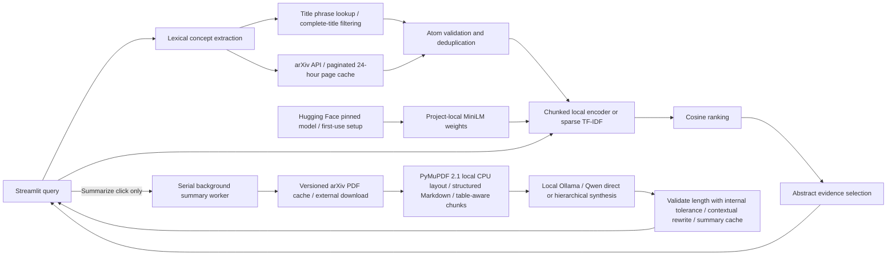
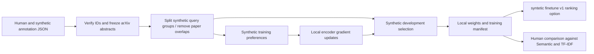
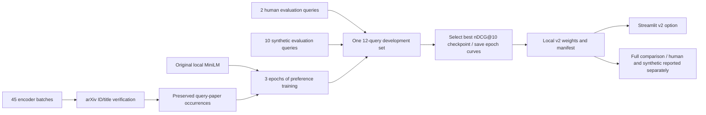

# Implemented architecture

Streamlit calls a UI-independent search/ranking pipeline in one Python process. Optional,
on-demand full-paper summaries use a separate local Ollama process serving Qwen3.5-4B.
Search/ranking works without that service. Application inference remains local; no vector
database is used. The separately invoked summary quality evaluator uses user-authorized
Google Gemini cloud inference through DeepEval, outside the application request path.

The offline evaluation boundary is independent of Streamlit:

`summary_eval_data.py` selects and validates records; `summary_evaluation.py` manages
durable summary/metric boundaries and resumption; `summary_eval_judge.py` owns Gemini,
rubrics and evidence budgets; `summary_eval_reports.py` computes reports without inference.
See [summary-evaluation.md](summary-evaluation.md) for cache identities, configuration,
cloud data sent, execution modes and limitations. The existing PDF/source and generated
summary provenance remain separate from judge configuration so changing a judge cannot
trigger summary generation.

| Component | Input | Output / purpose |
| --- | --- | --- |
| query.py | Original query | Conversational-prefix cleanup, complete title candidate, unique concepts and AND search, or preserved quoted phrase; original intent retained for ranking |
| retrieval.py | Search expression, limit | Validated Paper records, timestamp, cache status, skipped-record count |
| models.py | Untrusted metadata | Typed records with required fields and source links |
| ranking.py | Original query, titles and abstracts | Base or locally fine-tuned dense embeddings, or document-fitted TF-IDF vectors |
| pipeline.py | Query, client, encoder | Ranked matches, per-paper evidence, timings and provenance |
| app.py | User settings and query | Results, warnings, links, JSON download |
| summary_config.py | Environment configuration / model output | Validated settings, query normalization, plain text and internal 50–180 word acceptance for a 100–150 word prompt target |
| fulltext.py | Versioned arXiv ID / PDF | PDF cache, PyMuPDF 2.1 layout elements/Markdown, page and section provenance, complete chunks preserving table rows |
| ollama.py | Installed local model / prompt messages | Digest/version checks, context checks and bounded local inference |
| summarization.py | Paper and original query | Direct or hierarchical full-paper summary, provenance and query-specific cache |
| summary_jobs.py | Explicit per-paper requests | Serial background work, duplicate suppression, progress and retry state |

Retrieval parses each Atom response once for both validated papers and pagination metadata.
The preparation CLIs share `finetuning_data.fetch_metadata`, with strict singleton HTTP-400
handling retained for v1. Annotation loading constructs only the selected deduplicated or
occurrence-preserving representation. Both trainers share RNG setup and optimizer/scheduler
construction while retaining their distinct data/development protocols and original defaults.

Summary repairs retain existing all-chunk findings rather than extracting them again.
Persistent cache identity uses content-affecting settings; resource/job identity also includes
operational settings. The app polls only queued/running summaries. Timer start/stop transitions
perform a full rerun with tracked paper-expander state preserved by stable widget keys.

The PDF parser now calls `Document.to_markdown(page_chunks=True, use_ocr=False)` using
PyMuPDF 2.1's local ONNX layout analysis. This model call identifies reading order and element
classes from PDF content/geometry; it does not generate the scientific summary. The adapter
removes classified page headers/footers, retains captions, footnotes and formulas, and applies
bibliography/appendix boundaries. All returned pages and text spans are validated. Oversized
Markdown tables split only at row boundaries with repeated column headers. Unsupported
oversized structured blocks fail explicitly. The PDF parser version participates in summary
cache identity and provenance. Qwen inference remains local in Ollama; MiniLM ranking and
training are unchanged. See summarization.md for migration diagnostics and limitations.

The external call is HTTPS GET to export.arxiv.org/api/query. Requests from the shared
client are serialized with at least 3.1 seconds between starts, a 15-second connection timeout,
a 90-second read timeout, and up to three attempts per page for transient failures. Retrieval
accepts a maximum of 10,000 raw entries, using pages of at most 1,000. Offsets advance by raw
entry counts, independently of invalid metadata and duplicates. OpenSearch totalResults stops
pagination when the available result set is exhausted. A short page with no total count or
an empty page also terminates retrieval. The usable candidate count may be below the limit.
Base-model setup is handled by load_minilm in ranking.py. The project-local folder is
models/all-MiniLM-L6-v2, resolved against the repository rather than the current directory.
If absent, the pinned model is loaded from the existing Hugging Face cache when available;
otherwise setup downloads it from Hugging Face. Sentence Transformers saves weights,
tokenizer and module/configuration files to a temporary sibling directory. The recorded
pda_source.json identifies the repository and fixed revision. Only a completed installation
is renamed into place. Failed setup removes its temporary files and leaves the target absent
for a retry. Threads serialize initialization; competing processes accept a completed
installation of the same pinned model.

The staging directory is created with ordinary inherited project permissions and a unique
name, then removed after publication or failure. It does not use tempfile's owner-only
directory permissions, which can persist after a rename on Windows and prevent the normal
app account from reading a model installed by the coding sandbox. Permission failures while
reading source metadata are reported as access denied, separately from revision errors.

If the folder exists, its source record must match MODEL and REVISION, and loading uses its
absolute path with local_files_only=True. No Hub model identifier is resolved and no download
fallback is attempted for a corrupt or mismatched existing installation. Restore a complete
folder, or rename it before retrying setup. models/ remains ignored by Git. The first setup
reuses its in-memory model after saving; later instances load the project-local files.
Semantic inference thereafter is local using all-MiniLM-L6-v2 at a fixed revision in
ranking.py. The query is encoded once; title/abstract strings are processed in chunks of at
most 256 documents with inference batches of 16. Only one chunk's dense embeddings is needed
at a time; all scalar cosine scores are retained for global sorting. The lexical path uses
sparse document TF-IDF and materializes only the query-document score vector. The model can
truncate long texts, so evidence selection still uses the complete available abstract.
CPU is default; CUDA is optional through `uv sync --extra cuda` and
`uv run --extra cuda streamlit run app.py`. Availability is checked before loading the model.
TF-IDF provides a no-download lexical comparison.

`syntetic finetune v1` loads models/finetuned-minilm; `syntetic finetune v2` loads
models/syntetic-finetune-v2. Both use local training manifests. The shared encoder keeps the
same model inputs, cosine scoring, and chunk limits. JSON exports use the manifest's model
identity and training run ID; legacy v1 manifests retain the pda/syntetic-finetune-v1 identity.
Missing local weights produce a clear error.
This fine-tuned path does not create, download or replace the base-model installation.

The original v1 training flow was:

For v1, human labels were reserved from gradient updates and checkpoint selection. This is a modeling
and evaluation workflow; live retrieval and per-paper explanations share the same pipeline.
See finetuning.md for the executed protocol, limitations, and measured regression on human data.

V2 uses the original base encoder with all 45 encoder-training batches. Repeated query-paper
judgments are retained, including different grades for one paper under different queries.
The 12 human/synthetic evaluation queries are concatenated as query groups for a single
development mean and checkpoint selection. Their candidate pools remain separate. Outside
training, evaluate_annotations.py reports human and synthetic metrics separately for all
available models, including v2 when its manifest is present. V2's evaluation queries therefore
measure development performance. See finetuning-v2.md for the executed results and plots.

Cosine is retained raw; display score = 100 * max(0, cosine). This is an uncalibrated
similarity index. Stable ties retain retrieval order. Deduplication collapses arXiv version
suffixes while preserving the first retrieved version's original identifier.

Every valid query also performs an auxiliary `ti:"complete title candidate"` lookup for up
to 50 entries. It preserves all words, independent of topic stopword removal, and filters
returned papers by complete-title equality after Unicode NFKC, whitespace, and case
normalization. ASCII and smart outer quotes are accepted but not required. No title-prefix
or substring match receives exact-title priority. Quotes embedded inside title candidates
are sanitized before constructing the API expression.

Exact returned titles are merged with topic candidates and deduplicated by base arXiv ID,
with the combined usable pool capped at the requested limit. The auxiliary lookup can scan
up to 50 entries in addition to the topic entry budget; it uses the same rate limit/cache.
Exact titles precede other candidates, which remain sorted by cosine. Raw and displayed
cosine scores are unchanged. The UI labels title priority, and `title_lookup` records its
query, timestamps, cache status, and matching IDs. No paper is inserted by identifier.
Failed title lookup falls back to topic search with a visible warning; if only topic search
fails, successfully retrieved exact titles remain available with a partial-results warning.

For a query such as `graph learning`, concepts create an AND search, arXiv returns candidates,
the parser validates records, vectors are compared against the unchanged query, and the
highest-ranked papers receive the abstract sentence with greatest exact concept overlap.
Each ranked paper retains its abstract, selected evidence in JSON, similarity score and source link.
The UI shows matching terms and the abstract; the selected evidence section was replaced by
an on-demand **Summarize** control. Its query is the result's original query, independently
of any unsubmitted edits to the input form.
The user can request 5–50 displayed papers in increments of 5, with a default of 10.
The abstract-based overview was removed from both results and JSON export at the user's
request. An exact-overlap explanation remains incomplete evidence of semantic relevance,
especially for synonyms. No cross-paper consensus is generated. The optional summary path
is separate from ranking and uses every substantive section of that paper's extracted PDF
text. See [summarization.md](summarization.md) for its data flow, external/local API boundaries,
cache identity, limits, error behavior and extraction limitations. MiniLM models and training
are unchanged. All Qwen model installation is an explicit setup step.

Empty retrieval skips encoding. A failure before any page is retrieved appears as a UI error.
A later page failure preserves earlier candidates and produces an explicit partial-results
warning; failed pages are not cached. A retry reuses still-fresh successful pages. Each page's
timestamp and cache status is exported, so cached pages of different ages remain visible.
The progress indicator covers retrieval and ranking. Separate retrieval/ranking timings are
shown, and ui_total_seconds includes model loading. Model runtime failures appear as UI errors.
Paper text is displayed as text; source links are constructed from validated arXiv identifiers.
The cache stores retrieved metadata, not embeddings; no offline replay interface exists yet.
