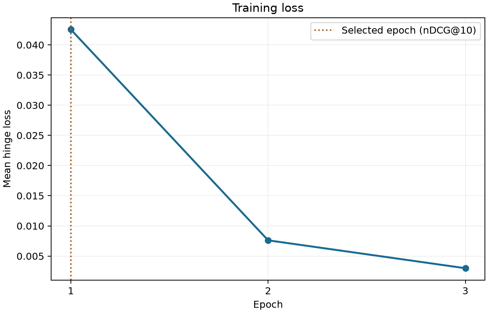
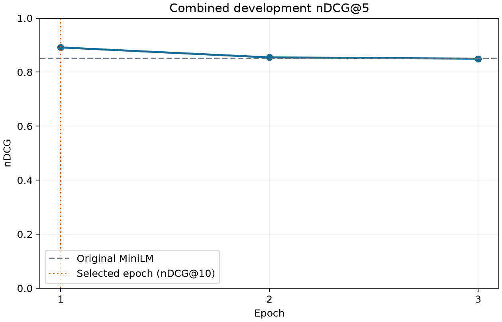
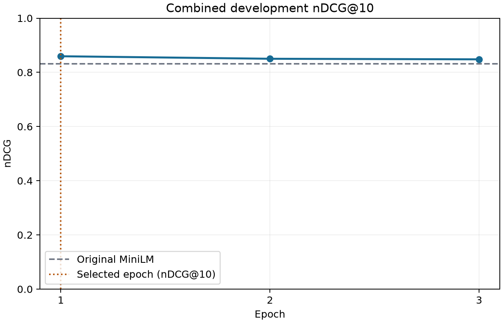
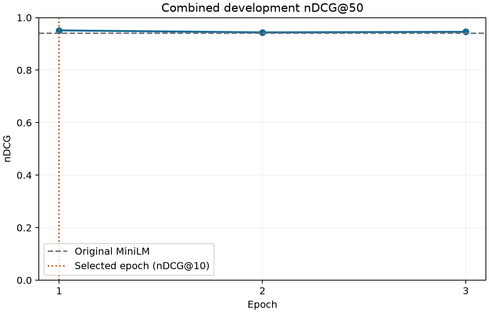

# Synthetic fine-tuning v2: executed experiment

Run 0ed76dc308849755 completed on 2026-11-08. The app now offers **syntetic finetune v2**
alongside Semantic, TF-IDF and v1. V2 starts from the original pinned MiniLM, not v1 weights.
The default remains Semantic. V1 and the base-model weights were preserved.

## Training data and arXiv verification

All 45 files in finetune_data/encoder were read: 45 query groups and 2,250 graded judgments.
The preparation runner looked up 2,089 distinct arXiv IDs using the existing serialized,
rate-limited client in batches of at most 50. Returned identifiers, canonical abstract links,
titles, abstracts, versions and timestamps are frozen in evaluation/finetuning-v2/prepared.json.
All 2,250 ID/title pairs passed the existing title-agreement threshold of 0.85. No records
were excluded, labels changed, or source annotation files modified.

Distinct IDs were fetched once for efficient metadata access; the **training dataset was not
deduplicated**. All query-paper occurrences remain in source order. There are 103 recurring
paper IDs, including 95 receiving different grades under different queries. Preference pairs
always compare papers within the same query, so those different labels are preserved.
The source and verified occurrence audits, file hashes and API provenance are saved.

Training/development paper overlap is retained as requested. Verified development pools
contain seven overlapping paper IDs for transformer architecture, two for CNN recognition,
three for contrastive learning, and one for differential privacy. Other development queries
have zero paper overlap. No development query text equals a training query text. These are
exposure checks, not evidence that the model has never seen related topics or benchmark text.

## Training configuration

The source of the original parameters is models/finetuned-minilm/training_manifest.json;
its hash is recorded in v2's manifest. Configuration:

| Parameter | Value |
| --- | --- |
| Initial model | sentence-transformers/all-MiniLM-L6-v2 |
| Revision | c9745ed1d9f207416be6d2e6f8de32d1f16199bf |
| Encoder input | Original query; paper title + abstract |
| Maximum input length | 256 word pieces, unchanged |
| Updated parameters | All encoder weights |
| Loss | Same-query pairwise cosine hinge |
| Margin | 0.1 * (better grade - worse grade) |
| Preference sampling | Up to 64 ordered pairs per query, seed 42 |
| Epochs / batch size | 3 / 8 preference triples |
| Optimizer | AdamW, learning rate 2e-5, weight decay 0.01 |
| Schedule | 10% warmup then linear decay; 107 warmup steps |
| Gradient clipping | Maximum norm 1.0 |
| Precision / device | Float32 / CUDA |
| Checkpoint selection | Highest combined development nDCG@10; first epoch wins ties |

Video action recognition supplies only 49 unequal-grade ordered pairs. Other queries supply
the cap of 64, giving **2,865 preference triples per epoch**, 359 optimizer steps per epoch,
and 1,077 total steps. Training uses the same seeded sampling and epoch shuffling as v1.
Epoch training loss is the arithmetic mean of observed batch losses, following v1; it is
not reweighted by the size of the last, smaller batch.

## Combined development set during training

The frozen evaluation snapshot remains evaluation/annotations/prepared.json: ten synthetic
query batches and two human batches, with 484 and 64 verified judgments respectively.
The previously recorded 17 evaluation-title exclusions are unchanged.

For training, these **12 query groups form one development set**. Each query is ranked against
its own judged candidate pool, and every query contributes 1/12 to the combined mean. Human
and synthetic groups are not given 50/50 weight, and papers from different query pools are
not merged or assigned artificial negative labels. Namespaced query IDs prevent collisions.

The combined set is used for checkpoint selection. Human labels do not supply gradient
updates, but they do influence which checkpoint is selected. Subsequent scores on these same
queries are development-set performance, not an independent final test. This protocol was
explicitly requested and differs from v1's synthetic-only development selection.

## Epoch history and plots

| Epoch | Mean training loss | Dev nDCG@5 | Dev nDCG@10 | Dev nDCG@20 | Dev nDCG@50 |
| --- | ---: | ---: | ---: | ---: | ---: |
| Original base | — | 0.851278 | 0.831883 | 0.821939 | 0.940018 |
| 1, selected | 0.042546 | 0.891315 | 0.859357 | 0.856842 | 0.951140 |
| 2 | 0.007609 | 0.854489 | 0.850097 | 0.851332 | 0.943602 |
| 3 | 0.002985 | 0.849796 | 0.847996 | 0.854195 | 0.945702 |

Loss decreased while development nDCG@10 declined after epoch 1. The saved v2 model is the
epoch-1 checkpoint. Full batch losses, per-query development rankings and every epoch's full
metrics are in evaluation/finetuning-v2/training-results.json. The compact table is also saved
as evaluation/finetuning-v2/epoch-metrics.csv. Each plot is exported in PNG and SVG.







## Post-training full evaluation: human queries

Results are saved in evaluation/results/ranking-comparison-full-v2.json. All four methods
use the same verified pools and full metric definitions; human and synthetic sources are
separated outside training. All previous comparison reports remain intact.

| Metric | TF-IDF | Semantic | V1 | V2 |
| --- | ---: | ---: | ---: | ---: |
| nDCG@5 | 0.7065 | 0.7997 | 0.7128 | 0.8097 |
| nDCG@10 | 0.7558 | 0.8168 | 0.7764 | 0.8138 |
| nDCG@20 | 0.8093 | 0.8183 | 0.7716 | 0.8236 |
| nDCG@50 | 0.9056 | 0.9311 | 0.8889 | 0.9355 |
| Precision@5 | 0.9000 | 0.9000 | 0.9000 | 0.9000 |
| Precision@10 | 0.9000 | 0.9500 | 0.9500 | 0.9000 |
| Precision@20 | 0.8000 | 0.8000 | 0.8000 | 0.8250 |
| MAP@10 | 0.8521 | 0.8952 | 0.8786 | 0.8627 |
| MAP@20 | 0.7257 | 0.7393 | 0.7272 | 0.7677 |
| MAP@50 | 0.8733 | 0.8842 | 0.8749 | 0.8984 |
| Pairwise accuracy@50 | 0.6587 | 0.6863 | 0.6644 | 0.7040 |
| MRR@50 | 1.0000 | 1.0000 | 1.0000 | 1.0000 |

## Post-training full evaluation: synthetic queries

| Metric | TF-IDF | Semantic | V1 | V2 |
| --- | ---: | ---: | ---: | ---: |
| nDCG@5 | 0.7898 | 0.8616 | 0.8972 | 0.9076 |
| nDCG@10 | 0.7953 | 0.8349 | 0.8645 | 0.8685 |
| nDCG@20 | 0.7697 | 0.8227 | 0.8532 | 0.8635 |
| nDCG@50 | 0.9168 | 0.9418 | 0.9518 | 0.9543 |
| Precision@5 | 0.8600 | 0.9600 | 0.9800 | 1.0000 |
| Precision@10 | 0.9000 | 0.9600 | 0.9600 | 0.9500 |
| Precision@20 | 0.8650 | 0.9450 | 0.9400 | 0.9550 |
| MAP@10 | 0.8302 | 0.9427 | 0.9433 | 0.9390 |
| MAP@20 | 0.7833 | 0.9165 | 0.9158 | 0.9300 |
| MAP@50 | 0.8675 | 0.9456 | 0.9349 | 0.9377 |
| Pairwise accuracy@50 | 0.6905 | 0.7824 | 0.7869 | 0.8023 |
| MRR@50 | 0.9500 | 1.0000 | 1.0000 | 1.0000 |

V2 improves synthetic nDCG at every recorded cutoff, but does not lead every metric. Original
Semantic has higher human nDCG@10 and MAP@10, and higher synthetic MAP@50. V2's improved
combined development score does not establish generalization to unseen user tasks. Synthetic
labels remain synthetic, there are only two human queries, and the same development data
selected the checkpoint. No significance test, live-retrieval recall measurement or score
calibration was performed. Abstract truncation and arXiv metadata limitations still apply.

## Resources, verification and reproduction

Training plus per-epoch development scoring/checkpoint writing took 104.04 seconds, excluding
initial model loading, baseline development scoring and plotting. Training-process peak working
set was about 1.62 GiB. PyTorch peak allocated CUDA memory was about 0.93 GiB and reserved
memory about 1.07 GiB; these exclude Streamlit, other processes and total device overhead.
The manifest records library versions and the actual resource values.

Software verification: 99 pytest cases passed; Ruff lint and formatting checks passed. Tests
cover retained occurrences and query-dependent grades, one combined query-level development
mean, real parameter updates in a small training fixture, the plot exports, v2 identity/UI
routing, and all four models in both evaluation modes. The 48 query/model outputs were checked
independently against scikit-learn nDCG, grade-pair-weighted ROC AUC and direct AP/Precision/MRR
calculations. The separated v2 nDCG aggregates reproduce the selected epoch's combined mean.
Existing baseline results, v1 weights, annotations and README hashes remain unchanged.
The real v2 CUDA model was loaded in Streamlit under the user's Windows account with mocked
retrieval; the ranked result rendered successfully.

From the repository root, the original run used:

```powershell
uv sync --extra cuda
uv run --extra cuda python scripts/prepare_finetuning_v2.py
uv run --extra cuda python scripts/train_ranker_v2.py --device cuda
uv run --extra cuda python scripts/evaluate_annotations.py --mode full --device cuda --output evaluation/results/ranking-comparison-full-v2.json
uv run --extra cuda python -m streamlit run app.py
```

These default artifact paths already contain the executed run. Retain the frozen prepared
snapshot to reproduce it exactly; re-fetching arXiv can change metadata. Use new --output paths
for preparation/model/evaluation reruns, and pass a new --results folder when retraining
against the same frozen preparation. Existing epoch results cannot be overwritten. For example:

```powershell
uv run --extra cuda python scripts/train_ranker_v2.py --output models/reproduced-v2 --results evaluation/finetuning-v2/reproduced-run
```

Plotting requires the Matplotlib development
dependency, recorded in pyproject.toml and uv.lock. Restart Streamlit to load the new selector
option. No hosted inference is used.
