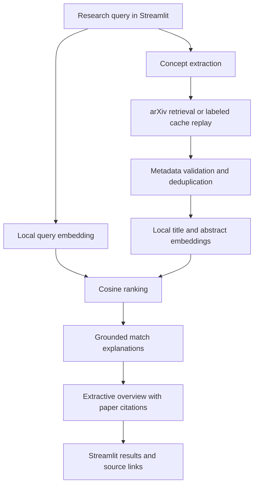

# Prototype plan (proposed)

Status: baseline architecture authorized by the request to implement. The Streamlit prototype,
automated tests, and fixed-corpus ranking evaluations are implemented. See architecture.md,
setup.md, evaluation.md, and implementation-results.md for actual behavior and verification.

## Scope and constraints

Build a local Streamlit application for English-language research queries and arXiv title/abstract search. Preserve paper identifiers, source links, raw similarity scores, and citation provenance. Initial scope excludes full-text analysis, accounts, cloud deployment, vector databases, and hosted inference.

Target hardware: laptop RTX 4060, 8 GB VRAM. Target system RAM below 8 GB, with an upper allowance of 12-13 GB when justified. Resource usage and latency must be measured on representative workloads. The user authorized up to 10,000 arXiv candidates and longer searches; use paginated retrieval, progress reporting, chunked semantic encoding, and sparse lexical scoring.

Internet access for paper retrieval through the arXiv API is approved. All NLP inference runs locally. Initial model downloads are setup dependencies rather than hosted inference. Propose cached retrieved records and an explicitly labeled replay mode for a repeatable offline demo.

## Baseline architecture

Streamlit calls ordinary Python components directly. Pydantic validates shared records. Use a lightweight, deterministic concept-extraction baseline, an arXiv retrieval client, metadata normalization/deduplication, a local Sentence Transformers encoder, NumPy cosine ranking, evidence-based match explanations, and an extractive abstract-based overview with source citations. Topic retrieval removes common conversational prefixes and requires retained concepts together; quoted phrases preserve their full wording. Optional Windows CUDA dependencies are selected with the cuda extra.

Start with extractive summaries and explanations. Consider a small local generative model only after the baseline works and evaluation identifies a concrete benefit. Exact model selection requires checking model documentation, licensing, input limits, and resource requirements.

The arXiv client makes an external API call. The encoder makes local model calls. Extractive explanations and overviews initially require no generative model. Store configuration, model revision, retrieval time, and stage timings for reproducibility.

## Evaluation before interpreting results

Investigate real academic retrieval datasets before preparing synthetic data. Check domain fit, licenses, accessible abstracts, relevance labels, and identifier compatibility. Evaluate ranking on a fixed judged corpus separately from live arXiv candidate retrieval; do not imply that ranking metrics establish arXiv-wide recall.

| Stage | Proposed quality evidence |
| --- | --- |
| Query interpretation | Human-labeled concept coverage and intent preservation, including negation and ambiguous queries |
| Retrieval | Coverage of known relevant papers where judgments permit; failures and scope of incomplete judgments |
| Preprocessing | Metadata completeness, duplicate-detection errors, and an audited sample |
| Embeddings | Separation of judged relevant and irrelevant query-paper pairs; compare lexical baseline |
| Ranking | nDCG@10 and Precision@5 against graded/binary judgments and a lexical baseline |
| Explanations | Human rubric for evidence support, relevance, and unsupported claims |
| Overview | Citation validity, human-reviewed factual support, and coverage of relevant source material |
| End to end | Representative task completion, measured latency, RAM/VRAM use, and failure cases |

Automated tests verify correctness separately: mocked API responses, malformed/missing metadata, identifier preservation, empty results, similarity calculations, citation membership, and pipeline integration. Extracting a source sentence does not by itself establish that it is useful or representative.

## Delivery sequence

The two-week window is a deadline, not a prescribed work duration. Proceed as quickly as dependencies and verification permit; do not wait for calendar milestones. The stages below describe a logical order and may overlap where appropriate. Preserve evaluation, testing, and documentation requirements while accelerating delivery.

1. Establish business requirements, investigate data, define evaluation criteria, document architecture, and create reusable skills.
2. Implement retrieval, metadata preparation, caching, and software tests.
3. Add embeddings, a lexical baseline, ranking, explanations, and Streamlit integration.
4. Add an extractive overview, citation validation, and the end-to-end workflow.
5. Run component evaluations, analyze errors, and measure resource use.
6. Fix issues, check reproducibility, complete the report and diagrams, and rehearse the demo.

## Planned files and acceptance

Application code will live under src/, with a Streamlit entry point, tests/, evaluation datasets/configurations/results, docs/, and actual reusable skills under .agents/skills/. Create installation/run instructions in docs/ without changing readme.md.

Acceptance: a query produces real retrieved papers, ordered scores explicitly described as similarity rather than probability, evidence-supported explanations, an abstract-based overview with resolvable citations, and clear handling of empty results/API failures. Include a reproducible evaluation command and actual per-component results, limitations, and demo cases. Do not claim quality, hardware compliance, or passing tests until measured.

## Risks and decisions to resolve

- arXiv API availability, rate limits, and clear handling of network failures.
- Whether the initial extractive overview satisfies the intended literature-overview experience.
- Dataset relevance to live arXiv search and the availability of independent human judgments.
- Local model downloads, input truncation, CPU/GPU compatibility, and measured memory use.
