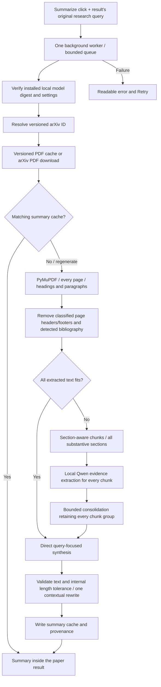

# Query-focused full-paper summarization

Each ranked paper has a **Summarize** button. It uses the original query belonging to those
search results, downloads that paper's versioned arXiv PDF, and requests a 100–150 word
summary from extracted full-paper text. An internal tolerance accepts 50–180 words;
the model is never told these tolerance bounds. Searching, ranking, expanding a result, and editing
the query form do not request inference. The previous **Selected abstract evidence:** UI
section is removed. Abstracts, matching terms, scores, metadata and source links remain.
The existing results JSON continues to describe ranking; summaries have their own cache.

## Install and run

Install [Ollama for Windows](https://ollama.com/download/windows) manually and start it.
In PowerShell, install the model once:

```powershell
ollama pull qwen3.5:4b
ollama list
ollama --version
```

The configured tag is the official [Qwen3.5 4B model](https://ollama.com/library/qwen3.5:4b).
If the desktop application is not serving the local API, run `ollama serve` in a separate
terminal. Do not start a second server if Ollama is already running. The app never calls
Ollama's pull endpoint and never installs models in response to a Summarize click.

From the project root, install the PDF dependency and restart Streamlit:

```powershell
uv sync --extra cuda
uv run --extra cuda python -m streamlit run app.py
```

The structured parser requires **PyMuPDF >=2.1,<3**; the lock file records the tested
2.1 release and its local layout/ONNX dependencies. To upgrade an existing environment
with pip, use the project's interpreter:

```powershell
.\.venv\Scripts\python.exe -m ensurepip --upgrade
.\.venv\Scripts\python.exe -m pip install --upgrade "pymupdf>=2.1,<3"
```

The first command is needed only if pip is absent from the uv-created environment.
Project metadata and `uv.lock` also carry the upgrade, so later uv launches preserve it.
PyMuPDF 2.1 installs its `pymupdf4llm`/layout compatibility packages as dependencies; app
code uses the public `pymupdf.Document` API. Layout inference runs locally on CPU.

Use `uv sync` and `uv run python -m streamlit run app.py` for the CPU ranking environment.
Streamlit's device selector controls MiniLM, while Ollama manages its own model placement.
Searching works without Ollama; an unavailable server/model produces a summary error with
Retry. Restart after changing source or environment variables because resources are cached
and the file watcher is disabled.

## Configuration

Set environment variables **before** launching Streamlit. Every field in
`src/pda/summary_config.py:SummarySettings` supports the `PDA_SUMMARY_` prefix:

```powershell
$env:PDA_SUMMARY_MODEL = "qwen3.5:4b"
$env:PDA_SUMMARY_ENDPOINT = "http://localhost:11434"
$env:PDA_SUMMARY_NUM_CTX = "8192"
$env:PDA_SUMMARY_TEMPERATURE = "0.2"
$env:PDA_SUMMARY_NUM_PREDICT = "768"
$env:PDA_SUMMARY_THINK = "false"
$env:PDA_SUMMARY_KEEP_ALIVE = "10m"
uv run --extra cuda python -m streamlit run app.py
```

| Setting suffix | Default | Purpose |
| --- | --- | --- |
| MODEL | qwen3.5:4b | Installed local Ollama tag |
| ENDPOINT | http://localhost:11434 | Loopback HTTP API; remote endpoints are rejected |
| NUM_CTX | 8192 | Context tokens reserved by Ollama |
| NUM_PREDICT | 768 | Maximum generated tokens per pass |
| TEMPERATURE / SEED | 0.2 / 42 | Generation settings; hardware/server determinism is not guaranteed |
| THINK | false | Request thinking disabled; unsupported flag errors retry without the flag |
| KEEP_ALIVE | 10m | Ask Ollama to retain loaded weights between requests |
| TIMEOUT_SECONDS | 180 | HTTP inference timeout; connect timeout is 5 seconds |
| MAX_RUNTIME_SECONDS | 1200 | Elapsed-time check between processing stages/model calls |
| MAX_PDF_BYTES | 41943040 | 40 MiB download limit |
| MAX_PAGES | 150 | PDF page limit |
| MAX_TEXT_CHARS | 300000 | Extracted input limit, including source labels |
| MAX_CHUNKS | 96 | Maximum full-paper map chunks |
| MAX_MODEL_CALLS | 192 | Logical generation calls, including length repair |
| MAX_REDUCE_ROUNDS | 6 | Maximum consolidation levels |
| TEMPLATE_RESERVE | 512 | Conservative allowance for chat template tokens |
| CACHE_DIR | project/.cache/full-paper | PDF and summary storage root |

The client uses the [Ollama chat API](https://docs.ollama.com/api/chat) with `stream:false`,
`think:false`, generation options and `keep_alive`. It checks installed names/digests through
the [model-list API](https://docs.ollama.com/api/tags), the server version, and `/api/show`
before inference or a disk-summary cache hit. It rejects model records delegating to a
remote host. These checks do not download weights. Updating Ollama may be necessary for
the selected model and thinking option.

Larger [context settings](https://docs.ollama.com/context-length) use more memory. Run
`ollama ps` during a real summary to inspect placement and context. No joint MiniLM/Qwen
RAM or VRAM compliance result is claimed yet. Reduce context or use CPU ranking if measured
concurrent use exceeds available memory; smaller context creates more summarization passes.

## Components and data flow



| Component | Responsibility |
| --- | --- |
| summary_config.py | Validated settings, normalization, result records and output validation |
| fulltext.py | Safe versioned IDs, rate-limited PDF cache, PyMuPDF extraction and chunking |
| ollama.py | Local model discovery, context checks, inference settings and API errors |
| summarization.py | Query/data prompts, direct or hierarchical strategy, coverage and summary cache |
| summary_jobs.py | One serial worker, deduplication of active requests, bounded queue and state snapshots |
| app.py | Per-paper button, progress polling, result, regeneration and retry |

The background queue allows at most four queued/running jobs in total, serializes model
inference, and disables the same paper/query button during work. Workers never call
Streamlit. Each requesting session polls snapshots once per second; completed summaries
remain within the corresponding result. A fresh session must explicitly request a summary
before accessing a shared job result/cache. Regenerate bypasses the summary cache and
reuses the PDF. A failed regeneration offers Retry. A query change uses a different key.
Summary buttons submit work in callbacks before the paper's summary fragment redraws;
they do not explicitly rerun the entire app or recreate the enclosing paper expander.
This preserves the user's open paper while starting, regenerating or retrying a summary.

## Full-paper coverage and limits

PDF URLs are constructed from validated arXiv IDs, including their version. An unversioned
result is resolved against the arXiv metadata API first. Downloads are separate from
search retrieval, with at least 3.1 seconds between request starts, three attempts for
transient failures, bounded size, and atomic writes inheriting project directory permissions.
The PDF cache has no age-based expiration because its key includes the paper version.

The parser calls [PyMuPDF 2.1's Document.to_markdown()](https://pymupdf.readthedocs.io/en/latest/document.html#Document.to_markdown)
with `page_chunks=True`, OCR disabled, image writing/embedding disabled, and `force_text=True`.
It consumes each page's Markdown and layout boxes (`class`, reading-order `index`, and text
offsets `pos`). Page count/provenance and nonoverlapping spans are checked; invalid or missing
layout output fails explicitly instead of falling back to the former low-level parser.
Text gaps not covered by a box and unknown future element classes are retained.

Layout classes supply headings, paragraphs, tables, captions, footnotes and formulas.
`TextUnit` keeps their kind, section, original page number and Markdown. Classified page
headers and footers are removed. The old body-font and repeated-margin heuristics are replaced
by native layout classification. Standalone bibliography headings start reference exclusion;
the adapter also handles an inline `**References** [1] ...` boundary merged into body text.
Substantive layout headings resume extraction after references, including unnamed supplements
such as Attention Visualizations. Unrecognized bibliography boundaries remain in the input.

For short papers the complete extracted input is supplied directly. Otherwise all
substantive paragraphs are packed into chunks with repeated section/page context. Oversized
paragraphs split at sentences, then word boundaries only as necessary. Tables stay intact
when they fit; oversized Markdown tables split only between complete rows, repeating the
column-header row and separator in each fragment. An unsplittable row or unsupported oversized
table format fails explicitly. Formula and fenced-code blocks are kept whole and fail if
they exceed the budget. There is no relevance filtering or top-chunk selection. Every chunk produces methodology, contribution, result
and limitation evidence, including important indirect findings. Consolidation groups carry
the union of their source chunk IDs; final coverage must include every original chunk.
This verifies processing coverage, not that a model preserved every scientific fact.

Input checks conservatively count UTF-8 bytes for Qwen's byte-level tokenizer and reserve
space for output and the chat template. Hierarchical chunks additionally reserve JSON-escape
space. This intentionally uses smaller inputs than an exact tokenizer would allow. Context
overflow, unsplittable text, excessive chunks/calls/pages/size/runtime, unfinished model output
and unsafe reported prompt sizes cause explicit failures. The code never slices a paper to
make it fit. Ollama's reported prompt token count is checked after each completed call.

The research query, title, full text and intermediate findings are serialized as untrusted
JSON data under fixed instructions. The model is told to ignore commands embedded in papers,
ground claims only in the supplied material, distinguish results from possible applications,
and acknowledge weak relevance. Prompt boundaries reduce instruction-injection risk; they
do not constitute a proof that a generated claim is supported.

## Cache and output validation

`.cache/full-paper/pdf/` stores PDFs separately, with source URL, timestamp and SHA-256 sidecars.
`.cache/full-paper/summaries/` stores validated text plus paper version, original query, model
digest, PDF hash, pipeline/PyMuPDF versions, page/chunk/call counts, and bibliography status.

The summary key includes versioned arXiv ID, Unicode NFKC/whitespace/case-normalized query,
installed model digest/tag, Ollama version, PyMuPDF version, pipeline version, settings fingerprint, and PDF
hash. Changing any of these invalidates reuse. Different queries share only the PDF.
Invalid summary cache records are ignored. Remove individual cache files to clear them;
do not remove model directories. The pipeline version must change when prompt/processing
semantics change in future implementations.

The prompt targets 100–150 words. Software accepts 50–180 words, so a shorter but nonempty
summary or a small overshoot such as 153 words can be shown and cached without regeneration.
Outputs below 50 words are treated as failed summaries and automatically retried.
These shadow bounds are internal validator constants, never final-summary or rewrite instructions.
Word counting uses Unicode word sequences, allowing internal hyphens/apostrophes.
Headings, lists, thinking tags, URLs and numbered citations are rejected.

An output outside the accepted range (or invalid format) triggers one automatic rewrite.
The rewrite receives the original research query, paper evidence, and rejected summary as
a separate untrusted JSON field. The draft is explicitly not factual evidence, and the
model is again instructed to return 100–150 words. If both evidence and draft cannot fit,
the complete paper is processed through the existing all-section hierarchy to make room;
neither input is silently truncated. A second invalid response produces a retryable error,
and invalid outputs are not cached. Pipeline version `full-paper-qwen-v4` (2026-11-10)
invalidates the previous summary cache policy while preserving downloaded PDFs.
This validation checks format and length, not scientific truth or relevance.

The 2026-11-09 follow-up passed all 169 tests and Ruff checks. Regression coverage includes
153-word acceptance/cache reuse, the 180/181-word boundary, inclusion of the rejected draft
alongside the original query and full-paper evidence, bounded repair failures, and retaining
all extracted words when a repair needs hierarchical processing to fit its context.

The subsequent UI/lower-bound fix passed all 178 tests and Ruff checks. Its regression
tests verify summary, regeneration and retry actions without explicit app-wide reruns,
retryable queue-submission errors, acceptance/cache reuse at 50 words, and contextual
rewriting at 49 words while keeping both shadow bounds out of the final-summary prompt.

## Verification and quality protocol

The PyMuPDF 2 migration acceptance criteria are: validate every returned source page,
retain unclassified text, remove identified bibliography without losing later supplements,
preserve multi-column reading order and synthetic table cell associations, and preserve all
extracted words in order during chunking (additional repeated table headers are allowed).
Native API/schema errors and unsafe structural splits must fail explicitly. Run the same
cached versioned PDFs through the smoke tool, preserving earlier reports. These checks and
layout/table diagnostics are component evidence, not a claim of scientific-summary faithfulness.

Executed on 2026-11-10: pip upgraded PyMuPDF from 1.28.2 to **2.1**, and `uv.lock` was
updated to match. The full suite passed **195 tests**, including native synthetic column/table
fixtures and explicit failure/coverage cases. `pip check`, Ruff lint/format checks and
`git diff --check` passed. The cached-PDF extraction checks below all preserved their
extracted words in order, removed detected bibliography and retained later substantive sections:

| arXiv version | Pages | Recognized tables | Chunks | Report |
| --- | ---: | ---: | ---: | --- |
| 1706.03762v7 | 15 | 4 | 16 | evaluation/summarization/fulltext-pymupdf2.json |
| 2304.10557v6 | 10 | 0 | 17 | evaluation/summarization/fulltext-pymupdf2-2304.10557v6.json |
| 2106.04554v2 | 40 | 2 | 52 | evaluation/summarization/fulltext-pymupdf2-2106.04554v2.json |

The migration summary is `evaluation/summarization/parser-migration.json`. Earlier reports
are retained. In the Transformer paper, native output now supplies section/subsection labels
and four Markdown tables, but the page-8 table still splits some BLEU/training-cost header
cells incorrectly. No cell values are inferred or repaired by the adapter. More or fewer
words/chunks than the old parser do not establish better extraction accuracy. These runs did
not invoke Qwen and do not measure summary quality or hardware compliance.

```powershell
uv run --extra cuda python -m pytest
uv run --extra cuda python scripts/verify_fulltext.py
```

The first command runs software tests with mocked inference and network responses, including
real synthetic PDFs, multiple section structures, appendix retention, all-word chunk coverage,
length boundaries, query/version/model/pipeline cache invalidation, API errors, background
deduplication and Streamlit loading/success/failure/regeneration states. No Ollama installation
is required for these tests. The second command downloads one actual versioned arXiv PDF
(default `1706.03762v7`) and saves extraction/chunking diagnostics in
`evaluation/summarization/fulltext-smoke.json`; it performs no model inference.

Executed on 2026-11-08: the complete suite passed **161 tests**, including **62 new** summary
tests, using `.venv/Scripts/python.exe -m pytest -q`. Ruff lint over `src`, `tests`, `scripts`
and `app.py`, formatting checks for the changed Python files, and `git diff --check` passed.
The real arXiv PDF check retrieved 2,215,244 bytes for `1706.03762v7`, extracted all 15 pages,
retained its post-reference Attention Visualizations section, excluded detected bibliography,
and preserved all 5,129 extracted words in order across 20 chunks. The report records the
PDF hash and settings. This is a single extraction smoke case, not an extraction-accuracy
estimate. A normal-account probe of `http://localhost:11434/api/tags` was refused, and Ollama
was not on PATH. No live Qwen inference, summary faithfulness evaluation, or joint memory
measurement was performed; those require the manual setup above.

Before judging actual generated summaries, freeze the paper IDs/versions, original queries,
PDF hashes, model digest, settings and pipeline version. Include direct, long hierarchical,
weak-relevance, appendix-heavy, multi-column, and extraction-failure cases. Have a human
read the full source and record:

1. Each factual claim's supporting page/section, including exact numerical conditions and
   whether the claim is reported evidence or an explicitly possible query application.
2. Coverage of the main contribution, methodology, important positive/negative findings and
   documented relevant limitations; record omissions and unsupported claims separately.
3. Query relationship and explicit acknowledgment of indirect or weak relevance.
4. Word count/format, extraction completeness, all-section processing, inference latency,
   cache behavior and measured peak RAM/VRAM.

Report claim-support rate and rubric scores only after this review, preserving individual
cases and failures. Compare the same paper under two distinct queries and review both
direct and hierarchical paths. Do not use this model's own judgments as sole quality labels.
Automated format/coverage checks and a successful download do not establish summary quality.

Known limits: no OCR, figure/image interpretation, vision-model input, or robust reconstruction
of mathematical notation and table layouts. A page without extractable text but with visual
content fails explicitly; partially unreadable figures or mixed scanned/text pages may still
need manual inspection. Native layout classification/reading order and custom bibliography
boundaries can be imperfect, especially with merged table cells and complex columns.
Only the first Markdown column-header row is repeated when splitting oversized tables;
multi-row/grouped headings may still need source review. No abstract-only fallback exists. Full-paper
here means the PDF's extractable substantive text, not a guarantee of reading graphical
results or perfectly recovering every equation. Scientific faithfulness, prompt-injection
resistance, latency and joint hardware use require a real-model assessment.
