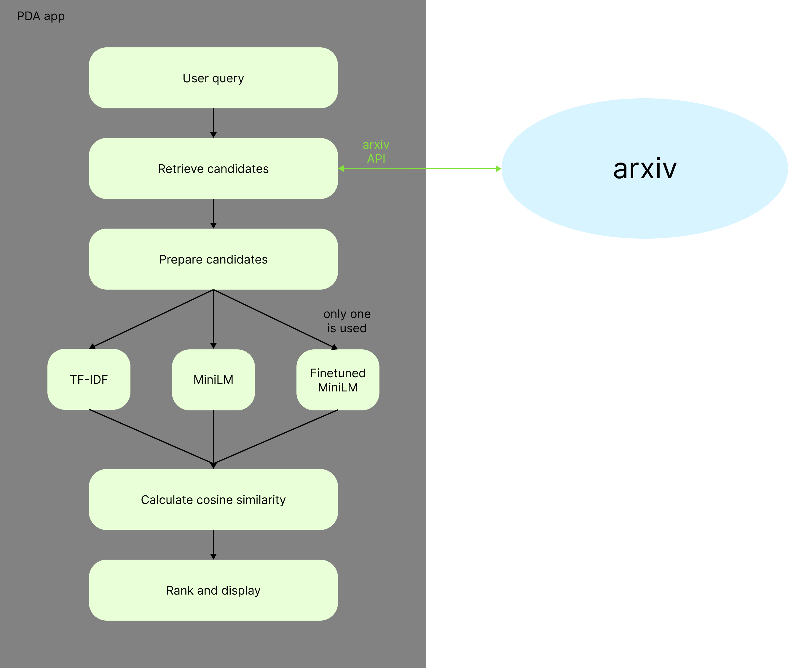

#### 1. Define the Task 
The Paper Discovery Assistant (PDA) is a tool for fast search of relevant papers on arXiv to the user query. 
The application should:
1. Interpret query and identify the key research concepts.
2. Search arXiv for potentially relevant papers.
3. Retrieve their titles, abstracts, authors, dates, categories, and links.
4. Rank the papers according to their relevance to your question.
5. Display a score, for each paper, along with an explanation of the match.
6. Let you open the original paper or abstract.
7. Generate a literature overview based on the retrieved papers, with citations linking back to the sources.

#### 2. Prepare the Data 
The baseline needs no additional training dataset, because it uses a pretrained encoder (MiniLM). There was an attempt to finetune the encoder. For it was created a syntetic dataset via ChatGPT6 consisting of 15 queries with 50 papers each ranked in relevancy from 0 to 3 and was collected manualy a 2 query human evaluation dataset with 32 and 33 papers.

#### 3. Describe the Components 
`Draw a diagram that shows the data flow. Describe the purpose, input, and output of each  component. Identify model calls and external tool calls. Explain how one input passes through  the complete system. You can use LLM for this task, but you must control the process.`

1. User inputs query, the rule based algorithm clears it from filler words removing filler words and extracting search terms. As a sanity check the whole query also cheked if it is a name of a paper, in that case, the exact paper would be displayed first no matter the similarity score.

2. The extraction of papers via key words is done using the official arxiv API and retrives up to 10000 candidates.

3. Candidate papers are then prepared: extracted title and abstract of each paper, and duplicate papers are deleted.

4. Selected by user algorithm encodes original query and title+abstract of each paper. (In case of TF-IDF the embedings are replaced with lexical TF-IDF vectors).

5. NumPy calculates cosine similarity between query vector and each paper.

6. The papers sorted by the similarity scores and selected ammount of them is displayed.

#### 4. Build the Prototype 
`Give the AI coding assistant a clear request and make sure you manage the instructions to your agent not only through cycles of prompting. You must create agents md file or convention md file or any other way to handle and steer agentic behaviour and context. Follow Crisp-dm by instructing your coding agent to do it properly, put instructions into the agents md or similar file.  `

#### 5. Evaluate the System 
`Evaluation is required for every component of the project. It can be also done by an LLM but you must be able to distinguish between high and low scores, think of how to improve it and explain why scores are not as good as they could be (if the case). The selection of metrics will also be judged, so make sure you choose proper metrics.`

run
cd "~\Paper Discovery Assistant"
uv sync --extra cuda
uv run --extra cuda streamlit run app.py

tests
uv run --extra cuda pytest -q

evaluation
uv run --extra cuda python scripts/evaluate_annotations.py --device cuda